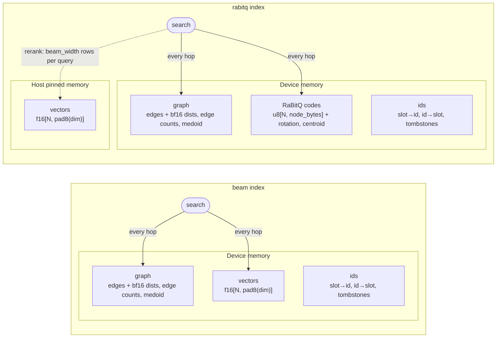

# Jasper API v1 (draft): build / search

Status: **draft** for cuVS integration. Language-neutral: types are abstract,
every operation takes an execution context `ctx` (CUDA stream + device memory
resource) as its first argument, and failures are reported as errors (never
`exit()`).

## 1. Conventions

| Term              | Meaning                                                                                                                                            |
| ----------------- | -------------------------------------------------------------------------------------------------------------------------------------------------- |
| `matrix<T>[r, c]` | Row-major view: pointer, rows, cols, row stride (elements), memory space. Any stride ≥ `c` is accepted; Jasper copies into its own padded storage. |
| memory space      | `device` or `host_pinned`                                                                                                                          |
| slot              | Internal row position. Changes only on `compact`.                                                                                                  |
| id                | Stable external id, `u32`. Never reused; unchanged by `consolidate` / `compact`.                                                                   |
| `INVALID_ID`      | `0xFFFFFFFF`                                                                                                                                       |

Limits: `N < 2^31` slots (search entries pack the slot in 31 bits), `dim ≥ 1`.

## 2. Enums and supported variants

| Enum             | Values                                                                                     |
| ---------------- | ------------------------------------------------------------------------------------------ |
| `IndexType`      | `beam`: graph + f16 vectors. `rabitq`: the same, plus RaBitQ codes.                        |
| `Metric`         | `L2`: distance = ‖q − x‖². `InnerProduct`: distance = −⟨q, x⟩. Smaller is closer for both. |
| `DType` (inputs) | `f32`, `f16`, `u8`, cast to f16 on ingest. Storage is always `f16`.                        |

Kernels are compiled per variant, so this set is closed: requesting anything
else is an error, not a slow path.

| Knob                 | Supported                           |     |
| -------------------- | ----------------------------------- | --- |
| `graph_degree` (R)   | 32, 64                              |     |
| build beam width (L) | 64, fixed                           |     |
| `search.beam_width`  | 1 – 1983 (`beam_width + 64 < 2048`) |     |
| RaBitQ `bits`        | 1, 2, 4, 8                          |     |

## 3. Index types

Both index types share the same graph. They differ in how search scores
candidates and in where the full vectors live.

| Type     | Contents                          | Search                                                                         |     |
| -------- | --------------------------------- | ------------------------------------------------------------------------------ | --- |
| `beam`   | graph, vectors, ids               | Beam search over the f16 vectors                                               |     |
| `rabitq` | graph, vectors, ids, RaBitQ codes | Beam search scored by RaBitQ estimates, then an exact rerank of the final beam |     |

The index type fixes where each component lives, so there is no
`memory_space` parameter:

- A `beam` index lives entirely in device memory.
- A `rabitq` index keeps the graph, ids and codes in device memory and the full vectors in host pinned memory. Its search walks the graph using only the codes. It reads full vectors only to rerank the final `beam_width` candidates of each query.



| Component | Contents |
|---|---|
| graph | Per-slot neighbor lists (slots + bf16 edge distances), medoid entry slot |
| vectors | `f16[N, dim]` |
| ids | slot→id, id→slot, tombstone bitmap, next id |
| RaBitQ codes (`rabitq` only) | Per-slot codes, random rotation `f32[dim, dim]`, rotated centroid `f32[dim]` |

Read-only properties: `index_type`, `dim`, `metric`, `graph_degree`, `size`
(slots), `n_live`, `n_tombstoned`, `rabitq_bits`.

## 4. Build

```
build(ctx, index_params, dataset: matrix<DType>[N, dim]) -> Index
```

`dataset` may be in `device` or `host_pinned` memory.

**index_params**

| Field | Type | Default | Notes |
|---|---|---|---|
| `index_type` | IndexType | `beam` | |
| `metric` | Metric | `L2` | |
| `graph_degree` | u32 | 64 | R |
| `alpha` | f32 | 1.2 | Robust-prune factor: 1.0 is strict, > 1 keeps long hops |
| `workspace_bytes` | u64 | 10 GiB | Device scratch budget; sets the insert batch size |
| `max_batch_size` | u32 | 0 = auto | auto = min(what fits in `workspace_bytes`, N / 50) |
| `rabitq.bits` | u32 | 4 | `rabitq` only |
| `rabitq.seed` | u64 | 0 | `rabitq` only; seeds the rotation |

A `rabitq` build constructs the graph with the vectors on the device. It then
quantizes them and moves the full vectors to host, so peak device memory during
the build matches a `beam` index.

The type of an existing index can be changed without rebuilding the graph:

- `quantize(ctx, index, rabitq_params)` turns a `beam` index into a `rabitq` index and moves its vectors to host. On a `rabitq` index, it requantizes with new parameters.
- `dequantize(ctx, index)` drops the codes and moves the vectors back to device, turning a `rabitq` index into a `beam` index.

## 5. Search

```
search(ctx, index, search_params,
       queries:   matrix<DType>[Q, dim],
       neighbors: out matrix<u32>[Q, k],
       distances: out matrix<f32>[Q, k])
```

Queries and outputs are in device memory. The caller allocates the outputs.
The search algorithm follows `index_type`.

**search_params**

| Field            | Type | Default                     | Notes                                                                                                |
| ---------------- | ---- | --------------------------- | ---------------------------------------------------------------------------------------------------- |
| `k`              | u32  | 10                          | 1 ≤ k ≤ `beam_width`                                                                                 |
| `beam_width`     | u32  | 64                          | Candidate list size, the main recall/QPS knob. For `rabitq`, also the number of candidates reranked. |
| `max_iterations` | u32  | 0 = auto (2 · `beam_width`) | Cap on expansion steps (today's `limit`)                                                             |

Semantics:

- Results are stable ids. Tombstoned vectors are never returned, but searches still traverse them until `consolidate`.
- Slots with no result get `INVALID_ID` and distance `+inf`.
- Distances are exact under `metric` (f16 data, f32 accumulation) for both types; `rabitq` gets them from its rerank.
- Placement follows the index type (§3). A `rabitq` search copies only the rerank candidates' vectors from host memory.
- Concurrency: searches may run concurrently with each other. Maintenance ops are exclusive (internal reader/writer lock).
- Errors: `beam_width` or `k` is out of range, or `dim` does not match.

## 6. Maintenance

| Op             | Args                                                                  | Returns       | Notes                                                                                                                                    |
| -------------- | --------------------------------------------------------------------- | ------------- | ---------------------------------------------------------------------------------------------------------------------------------------- |
| `extend`       | `vectors: matrix<DType>[n, dim]`, `alpha` = 1.2, `max_batch_size` = 0 | `ids: u32[n]` | New ids increase monotonically. For `rabitq`, the new vectors are quantized with the existing rotation and centroid, and stored on host. |
| `mark_deleted` | `ids: u32[m]`                                                         | none          | Soft delete; unknown ids are ignored                                                                                                     |
| `consolidate`  | `alpha` = 1.2                                                         | none          | Repairs edges around tombstones and clears them; slots unchanged                                                                         |
| `compact`      | none                                                                  | none          | Consolidates if needed, then packs live slots into `[0, n_live)`; ids unchanged. RaBitQ codes move with their slots.                     |
| `get_vectors`  | `ids: u32[m]`, `out: matrix<f16>[m, dim]`                             | none          |                                                                                                                                          |
|                |                                                                       |               |                                                                                                                                          |

The RaBitQ centroid is fixed at `build`/`quantize` time. Call `quantize` again if
the data distribution drifts. On a `rabitq` index, `extend` and `consolidate`
read full vectors from host memory to compute exact edge distances, so they run
slower than on `beam`.

## 7. Serialization

```
serialize(ctx, index, sink)
deserialize(ctx, source) -> Index
```

The file is self-describing: loading needs no dim, R, dtype or metric from the
caller. Layout is little-endian: `[header 64 B][section table][sections]`,
with each section 64-byte aligned. The index type follows from which sections
are present.

**Header**

| Offset | Field | Type |
|---|---|---|
| 0 | magic `"JASPERIX"` | u8[8] |
| 8 | format version (= 1) | u32 |
| 12 | metric | u32 |
| 16 | storage dtype (f16 = 1) | u32 |
| 20 | dim | u32 |
| 24 | graph_degree R | u32 |
| 28 | n_sections | u32 |
| 32 | N (slots) | u64 |
| 40 | next_id | u64 |
| 48 | medoid (slot) | u64 |
| 56 | n_tombstoned | u64 |

**Section table**: `n_sections` entries of `{kind u32, reserved u32, offset u64, bytes u64}`.

| Kind | Section | Layout |
|---|---|---|
| 1 | vectors | `f16[N, dim]`, unpadded rows |
| 2 | edge_counts | `u8[N]` |
| 3 | edges | `u32[N, R]` neighbor slots; entries at or past `edge_counts[i]` are ignored |
| 4 | edge_dists | `bf16[N, R]`, d(node, neighbor); lets updates skip recomputing distances |
| 5 | slot_to_id | `u32[N]` |
| 6 | tombstones | `u8[⌈N/8⌉]`, bit i (LSB-first) = slot i |
| 7 | rabitq | `u32 bits`, `u64 seed`, `f32[dim, dim]` rotation, `f32[dim]` rotated centroid, then `u8[N, node_bytes]`. A node holds the code (bits · dim bits, LSB-first, padded to 4 B), `f32 f_add` and `f32 f_rescale`. |
| 8, 9 | extensions | See §9 |

Not stored: the id→slot hash table (rebuilt on load), row padding and build
workspace. The reader also accepts today's format (v0, no magic) if the caller
supplies dim, R, dtype and metric.

## 8. In-memory layout (informational, not API)

- Slots are grouped in segments of 2^20, and storage is allocated one segment at a time.
- Each segment is structure-of-arrays:
  - vectors: `f16[2^20, pad8(dim)]`, zero-padded so rows are 16 B aligned. On device for `beam`, host pinned for `rabitq`.
  - edge lists: one `{u32[R], bf16[R]}` struct per slot
  - `u8` edge counts, `u32` tombstone words, `u32` slot_to_id
- RaBitQ codes are one flat device array indexed by slot.
- id→slot is a GPU hash table (WarpSpeed).

| Bytes per slot | Device | Host | dim 128, R 64 |
|---|---|---|---|
| `beam` | 2 · pad8(dim) + 6R + 5 | none | 645 device |
| `rabitq` | 6R + 5 + align4(⌈bits · dim / 8⌉) + 8 | 2 · pad8(dim) | 461 device + 256 host (4-bit) |

Both types also use 1 bit per slot of device memory for tombstones.

## 9. Extensions: scale-out build and directional search

**Scale-out build.** `index_params.n_partitions` (u32, default 1) builds
datasets larger than device memory. A value > 1 builds that many partitions
independently on the device, then merges them pairwise; 0 derives the count
from `workspace_bytes`. The dataset must be in `host_pinned` memory. It works
with either index type and produces the same index format.

**Directional search.** A third index type, `directional`, adds a random
orthogonal rotation `P: f32[dim, dim]` and per-edge LSH sketches, so search can
skip neighbors that point away from the query. It keeps the graph, vectors and
sketches in host pinned memory, for datasets that don't fit on the device.

- Build parameters: `directional.k_ranks` u32 = 4 (4, 8 or 16), `directional.n_samples` u32 = 16384 (edges sampled to calibrate the sketch constants), `directional.seed` u64 = 42 (seeds both the rotation and the sampling).
- Supported: `L2` only, R = 64, `dim` ≤ 32768.
- The index stores the rotated vectors and rotates queries and `extend` input itself. Distances are unchanged, because P is orthogonal (up to f16 rounding). `get_vectors` returns vectors in the original space.
- `extend`, `consolidate` and `compact` repopulate the sketches in one pass over all edges.
- Serialized sections:

| Kind | Section | Layout |
|---|---|---|
| 8 | rotation | `u64 seed`, then `f32[dim, dim]` P, column-major |
| 9 | directional | `u32 k_ranks`, `u32 word_bytes` (1 if dim ≤ 128, else 2), `f32 c_per_rank[k_ranks]`, `f32 norm_denom`, then `u8[N, R, row_bytes]`. A row holds `k_ranks` words (MSB = sign, low bits = coordinate) and a bf16 ‖v − u‖², padded to 4 B. |

- Memory: R · align4(k_ranks · word_bytes + 2) extra bytes per slot (512 for k = 4, R = 64).

## 10. Changes from today's code

- The file is self-describing. Today `load` needs dim and R, and `save`/`load` call `exit()` on I/O failure.
- Strides are explicit. Today the FFI assumes a row stride of `pad8(dim)`, so contiguous tensors with `dim % 8 ≠ 0` are read at the wrong offsets.
- RaBitQ codes survive `extend` and `compact`. Today both drop the codes, and the caller must rebuild them.
- A `rabitq` index keeps its full vectors on host and the graph on device. Today one `on_host` flag per segment places edges and vectors together, so the vectors need their own placement.
- Directional indexes own their rotation and keep their sketches current. Today the caller rotates queries, `append` doesn't rotate new vectors, and mutations leave the sketches stale.
- `max_iterations` defaults to auto; empty results get `+inf` instead of `1e30`.

## 11. Open questions

1. **Id width.** Internally ids are `u32`, capped at 2^31 − 1. Should the boundary expose `i64` ids (widened on output), or keep `u32`?
2. **Input dtypes.** Storage is f16 only. Accept f32/u8 with a cast on ingest (as drafted), add `i8`/`bf16`, or require f16?
3. **v1 scope.** Should v1 include maintenance (§6), or only build plus search?
4. **All-device `rabitq`.** Should `rabitq` also allow its vectors on device, for datasets that fit? That would skip the host round trip during rerank.
5. **Graph degree.** Ship only {32, 64}? The FFI also compiles 8 and 16, and CLI help mentions 128, which isn't compiled.
6. **Build L.** Keep it fixed at 64, or expose `build_beam_width`? Exposing it means compiling more variants.
7. **Format break.** Is the new v1 file format acceptable, with v0 kept as read-only legacy?
